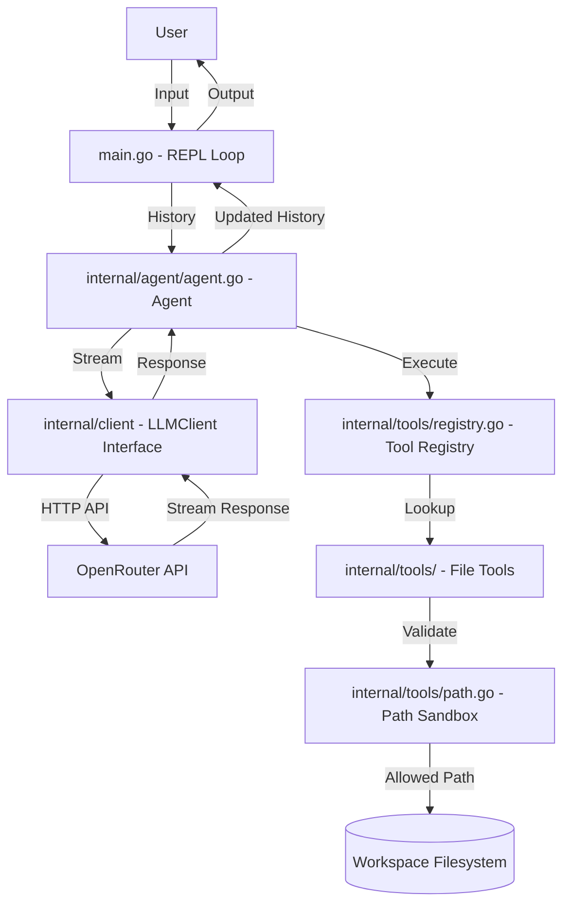
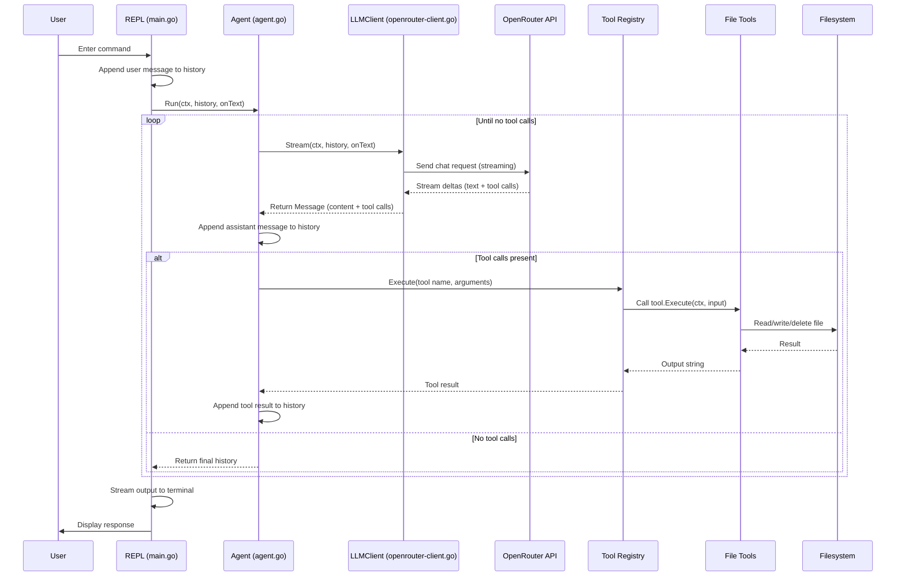

# zerrcode Architecture

This document describes the architecture of **zerrcode**, an interactive command-line coding assistant written in Go that uses an LLM (via OpenRouter) to read, write, list, and delete files in a workspace through natural conversation.

## Project Structure

```
zerrcode/
├── main.go                 # CLI entry point and REPL loop
├── go.mod                  # Go module definition
├── go.sum
├── .env                    # Local environment variables (OPENROUTER_API_KEY)
├── .gitignore
├── LICENSE
├── README.md
├── docs/
│   └── architecture.md     # This file
└── internal/
    ├── agent/
    │   └── agent.go        # Agent loop: LLM calls + tool execution
    ├── client/
    │   ├── client.go       # LLMClient interface, Message, ToolCall types
    │   └── openrouter-client.go  # OpenRouter SDK implementation
    └── tools/
        ├── tool.go         # Tool interface
        ├── registry.go     # Tool registry (register/get/execute)
        ├── path.go         # Workspace path traversal protection
        ├── read_file.go    # read_file tool
        ├── list_files.go   # list_files tool
        ├── write_file.go   # write_file tool
        └── delete_file.go  # delete_file tool
```

## High-Level Component Diagram



## Data Flow Diagram

```mermaid
flowchart TB
    subgraph REPL["main.go - REPL Loop"]
        A[Read user input] --> B[Append user message to history]
        B --> C[Call Agent.Run(ctx, history, onText)]
        C --> D[Stream output to terminal]
        D --> E[Update history with assistant response]
    end

    subgraph Agent["internal/agent/agent.go - Agent Loop"]
        F[Call client.Stream()] --> G{Tool calls present?}
        G -->|Yes| H[Execute tools via Registry]
        H --> I[Append tool results to history]
        I --> F
        G -->|No| J[Return final history]
    end

    subgraph Client["internal/client/openrouter-client.go - OpenRouter Client"]
        K[Convert messages to SDK format] --> L[Send streaming request to OpenRouter]
        L --> M[Parse deltas: text + tool calls]
        M --> N[Invoke onText callback for streaming]
        M --> O[Assemble final Message with ToolCalls]
    end

    subgraph Registry["internal/tools/registry.go - Tool Registry"]
        P[Look up tool by name] --> Q{Tool found?}
        Q -->|No| R[Return error]
        Q -->|Yes| S[Execute tool with arguments]
    end

    subgraph Tools["internal/tools/ - File System Tools"]
        T[read_file]
        U[list_files]
        V[write_file]
        W[delete_file]
    end

    subgraph Security["internal/tools/path.go - Path Sandbox"]
        X[resolveInWorkspace(root, path)]
        Y[Check path is within workspace root]
        Z[Reject path traversal attempts]
    end

    E --> A
    S --> X
    X --> Y
    Y -->|Allowed| FS[(Workspace Filesystem)]
    Y -->|Blocked| Z
    Z --> R
```

## Agent Loop (Iterative Tool Use)



## Component Details

### 1. `main.go` — CLI Entry Point & REPL Loop

- Loads environment variables (`.env`) via `godotenv`
- Reads `OPENROUTER_API_KEY` from environment
- Initializes `OpenRouterClient` and `ToolRegistry`
- Registers four built-in tools: `read_file`, `list_files`, `write_file`, `delete_file`
- Runs an interactive REPL loop:
  - Reads user input from stdin
  - Maintains conversation `history` (`[]client.Message`)
  - Calls `agent.Run()` with history and a streaming callback
  - Prints streamed output to terminal
  - Exits on `exit` command or `Ctrl+D`

### 2. `internal/agent/agent.go` — Agent Loop

- Struct holds `LLMClient` and `*tools.Registry`
- `Run()` method implements the iterative tool-use loop:
  1. Calls `client.Stream()` with current history
  2. Appends assistant response (with any tool calls) to history
  3. If tool calls are present:
     - Executes each tool via `registry.Execute()`
     - Appends tool results (role: `tool`) to history
     - Loops back to step 1
  4. If no tool calls, returns final history

### 3. `internal/client/client.go` — LLM Client Interface

Defines core types:

| Type | Description |
|------|-------------|
| `Role` | Message role: `user`, `assistant`, `system`, `tool` |
| `Message` | Content, role, optional tool calls, optional tool call ID |
| `Response` | Content + tool calls (non-streaming) |
| `ToolCall` | ID, name, arguments (JSON string) |
| `StreamEvent` | ID, message, error |
| `LLMClient` | Interface with `Send()` and `Stream()` methods |

### 4. `internal/client/openrouter-client.go` — OpenRouter Implementation

- Wraps the `github.com/OpenRouterTeam/go-sdk` client
- `Stream()` implementation:
  - Converts internal `Message` types to SDK format
  - Sends streaming chat request with all four tool definitions
  - Parses SSE event stream for text deltas and tool call deltas
  - Invokes `onText` callback for real-time terminal output
  - Assembles final `Message` with accumulated content and tool calls
- `convertToChatRequest()` builds the SDK request with:
  - Model: `nvidia/nemotron-3.5-super-vl:free`
  - Stream: `true`
  - Tools: `read_file`, `list_files`, `write_file`, `delete_file`
- Role mapping: `user`, `assistant`, `system`, `tool`

### 5. `internal/tools/tool.go` — Tool Interface

```go
type Tool interface {
    Name() string
    Description() string
    Execute(ctx context.Context, input string) (string, error)
}
```

### 6. `internal/tools/registry.go` — Tool Registry

- In-memory map of `string` → `Tool`
- `Register(tool)` — adds a tool by name
- `Get(name)` — retrieves a tool by name
- `Execute(ctx, name, input)` — looks up and executes a tool

### 7. `internal/tools/path.go` — Path Sandbox (Security)

- `resolveInWorkspace(root, p)` resolves a user-supplied path against the workspace root
- Uses `filepath.Abs`, `filepath.Join`, `filepath.Rel`
- Rejects paths that escape the workspace (`..`, path traversal)
- Prevents directory escape attacks

### 8. File System Tools

| Tool | Name | Description | Safety |
|------|------|-------------|--------|
| `read_file.go` | `read_file` | Read file contents | Path sandbox + regular file check |
| `list_files.go` | `list_files` | List directory entries | Path sandbox + directory check |
| `write_file.go` | `write_file` | Create/overwrite file | Path sandbox + parent dir creation |
| `delete_file.go` | `delete_file` | Delete a file | Path sandbox + no directories |

All tools:
- Parse JSON input arguments
- Validate required fields
- Reject unknown fields
- Check context cancellation (`ctx.Done()`)
- Return descriptive error messages

## Security Model

```mermaid
graph TD
    UserInput[User-supplied path] --> Join[filepath.Join(root, input)]
    Join --> Abs[filepath.Abs()]
    Abs --> Rel[filepath.Rel(root, resolved)]
    Rel --> Check{rel == ".." or starts with "../"?}
    Check -->|Yes| Reject[Reject: path outside workspace]
    Check -->|No| Allow[Allow: path within workspace]
    Allow --> FS[Filesystem operation]
```

**Security guarantees:**
- All file operations are confined to the workspace directory
- Path traversal (`../../etc/passwd`) is blocked
- Symlink escape is mitigated by `filepath.Abs` + `filepath.Rel`
- Directories cannot be deleted (only files)
- Context cancellation is respected during I/O

## Error Handling

| Layer | Strategy |
|-------|----------|
| `main.go` | Logs fatal on missing API key; prints request errors; continues REPL loop |
| `agent.go` | Returns error from `client.Stream()`; tool errors are captured and appended to history as tool messages |
| `openrouter-client.go` | Returns wrapped errors from SDK; validates non-nil response and event stream |
| `tools/` | Returns descriptive errors for invalid args, missing files, path violations, I/O failures |

## Dependencies

| Package | Purpose |
|---------|---------|
| `github.com/OpenRouterTeam/go-sdk v0.9.61` | OpenRouter API client (chat completions, streaming) |
| `github.com/joho/godotenv v1.5.1` | Load `.env` file |
| `github.com/spyzhov/ajson v0.8.0` | Indirect (JSON utilities) |

## Build & Run

```bash
# Clone and enter directory
git clone https://github.com/Aneeshie/zerrcode.git
cd zerrcode

# Install dependencies
go mod tidy

# Create .env with your OpenRouter API key
echo "OPENROUTER_API_KEY=your_key_here" > .env

# Run
go run main.go

# Or build binary
go build -o zerrcode .
./zerrcode
```

## Example Conversation Flow

```text
zerrcode > list the files in the current directory
[Tool: list_files | Args: {}]
main.go
go.mod
internal/
README.md
...

zerrcode > read main.go and explain what it does
[Tool: read_file | Args: {"path":"main.go"}]
[Streaming LLM response...]

zerrcode > write a new file called hello.go that prints "Hello, World"
[Tool: write_file | Args: {"path":"hello.go","content":"package main..."}]
created hello.go (87 bytes)

zerrcode > exit
Goodbye!
```

docs were generated by zerrcode <3
