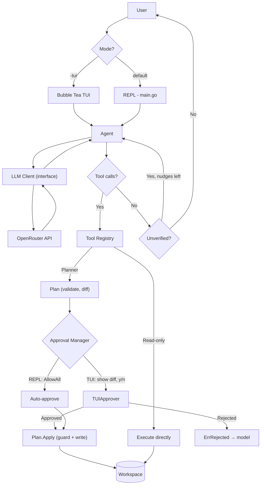
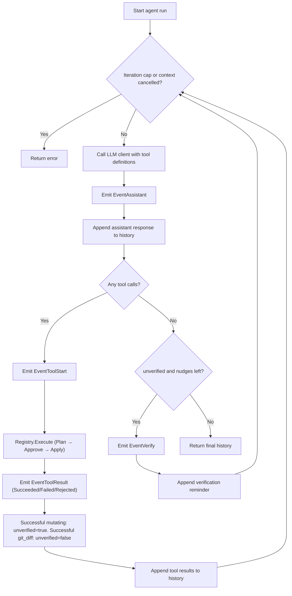
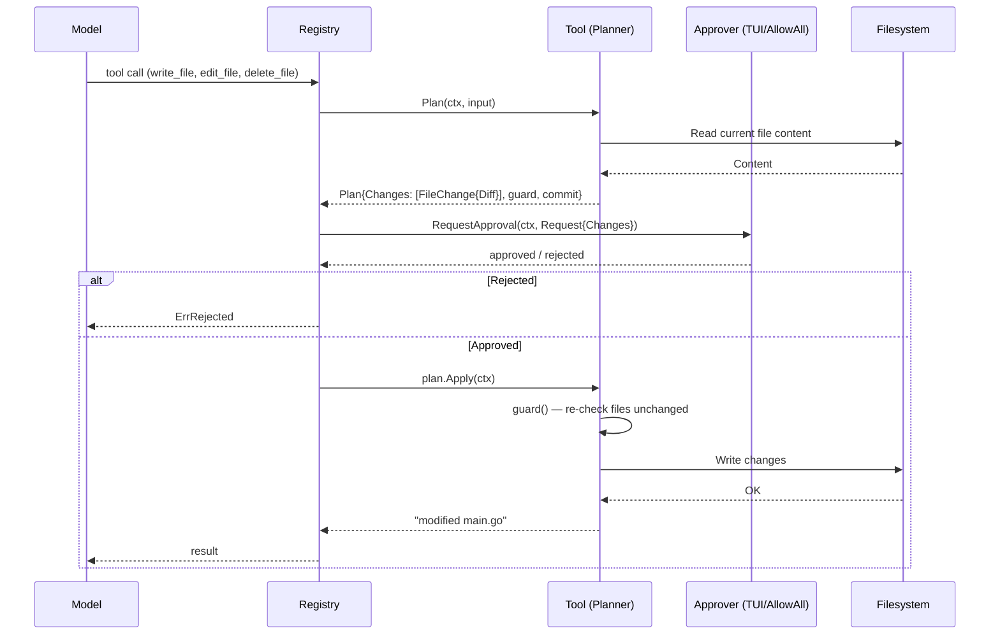

# zerrcode

**An interactive AI coding assistant built in Go.**

`zerrcode` is a command-line coding assistant powered by an LLM through [OpenRouter](https://openrouter.ai/). It can understand natural-language requests, interact with files in a workspace, and execute tools through an iterative agent loop — with an optional full-screen TUI that lets users review and approve every change before it touches disk.

## Features

- **Two interaction modes** — a classic REPL (auto-approves) and a full-screen Bubble Tea TUI (interactive approval).
- **Streaming responses** — receive generated text as it arrives.
- **Tool calling** — the model can request file operations based on your instructions.
- **Built-in tools** — read, list, search, write, edit (multi-file patches), and delete files, plus a read-only `git_diff`.
- **Iterative agent loop** — execute tool calls, append their results to conversation history, and continue until the model returns a final response. The loop is bounded and cancellable.
- **Verification before completion** — after changing files the agent must inspect `git_diff` before it is allowed to finish.
- **Honest reporting** — the system prompt separates commands the agent actually ran from ones it could not run.
- **Interactive approval** — in TUI mode, every workspace-changing tool call shows a real before/after diff for the user to approve or reject.
- **Optimistic concurrency** — if a file changes while waiting for approval, the write is refused rather than silently overwriting.
- **Workspace path validation** — reject paths that escape the workspace, including through symlinks.
- **Context-aware execution** — propagate context cancellation through agent and tool operations.
- **Modular architecture** — the agent, LLM client, tools, permissions, diff, and TUI are separate packages behind interfaces.
- **Event system** — the agent emits events (assistant response, tool start/result, verification nudge) that any UI can observe without the agent printing directly.

## Built With

- **Go** — core application and agent implementation.
- **OpenRouter** — LLM API access.
- **OpenRouter Go SDK** — chat completions, streaming, and tool calling.
- **Bubble Tea v2** — terminal UI framework (TUI mode).
- **Lipgloss v2** — terminal styling (via x/ansi for width calculations).
- **go-udiff** — unified diff computation for the approval UI.
- **go-gitdiff** — parsing and applying unified diffs for `edit_file`.
- **godotenv** — loading environment variables from `.env`.

## Requirements

- Go 1.27 or later (see `go.mod`).
- An OpenRouter API key.
- Git (also used at runtime by the `git_diff` tool).
- `grep` (used by the `search_code` tool).
- A terminal with true-color support (for the TUI mode).

## Getting Started

### 1. Clone the repository

```bash
git clone https://github.com/Aneeshie/zerrcode.git
cd zerrcode
```

### 2. Install dependencies

```bash
go mod tidy
```

### 3. Configure your API key

Create a `.env` file in the project root:

```env
OPENROUTER_API_KEY=your_openrouter_api_key
```

Get your API key from [OpenRouter](https://openrouter.ai/).

**Important:** Never commit your API key or other secrets to version control.

### 4. Run zerrcode

**TUI mode (recommended):**

```bash
go run . -tui
```

**Classic REPL mode:**

```bash
go run .
```

### 5. Build the executable

```bash
go build -o zerrcode .
./zerrcode -tui
```

## Usage

### TUI Mode (`-tui`)

The TUI provides a full-screen chat interface with interactive change approval:

- Type your request and press Enter.
- When the agent proposes a file change, you see a real diff and press **y** to approve or **n** to reject.
- Press **d** to toggle the diff preview, **Tab** to cycle through affected files.
- Press **Ctrl+C** or **Esc** to cancel a running turn.
- Type `/help` for available commands, `/clear` to reset the view, `/exit` to quit.

### REPL Mode (default)

The classic REPL auto-approves all changes (matching the behaviour before the TUI was added):

```text
zerrcode — type 'exit' to quit.

zerrcode > list the files in the current directory
zerrcode > read main.go and explain what it does
zerrcode > create hello.go that prints Hello, World
zerrcode > rename the variable x to count in main.go
zerrcode > exit
```

## Built-in Tools

`zerrcode` exposes workspace operations to the model through a tool registry.

| Tool | Changes workspace | Purpose |
|---|---|---|
| `read_file` | no | Read the contents of a file. |
| `list_files` | no | List files and directories within a directory. |
| `search_code` | no | Literal-text search across files (wraps `grep`). |
| `git_diff` | no | Show changed files and the diff against `HEAD`. |
| `write_file` | yes | Create a file or fully overwrite one. |
| `edit_file` | yes | Apply a multi-file unified diff, all-or-nothing. |
| `delete_file` | yes | Delete a file. |

Each tool implements the common `Tool` interface and describes itself:

```go
type Tool interface {
    Name() string
    Description() string
    InputSchema() map[string]any
    Execute(ctx context.Context, input string) (string, error)
}

// Optional: tools that change the workspace implement Mutator and Planner.
type Mutator interface { Mutates() bool }
type Planner interface { Plan(ctx context.Context, input string) (*Plan, error) }
```

Workspace-changing tools (`write_file`, `edit_file`, `delete_file`) implement the `Planner` interface. Their `Plan` method validates the request and computes the result (including a real before/after diff) without writing anything. The `Registry.Execute` method then shows the plan to the approval manager and only applies it if approved.

For how every tool works in detail see [`tools.md`](tools.md).

## How It Works

The application follows an iterative agent architecture with an approval layer.

1. The user enters input (via REPL or TUI).
2. The input is appended to the conversation history (which starts with the system prompt).
3. The agent builds tool definitions from the registry and sends the history to the LLM client.
4. The client streams the response and assembles any tool calls. The agent emits events that the UI observes.
5. If the model requests a workspace-changing tool:
   a. The tool's `Plan` method validates the request and computes the result in memory.
   b. The registry sends the plan (with real diffs) to the approval manager.
   c. In TUI mode, the user sees the diff and approves/rejects. In REPL mode, changes are auto-approved.
   d. If approved, `Plan.Apply` re-checks that affected files haven't changed (guard), then writes.
   e. If rejected, `ErrRejected` is returned to the model so it can ask the user how to proceed.
6. Tool results are appended to the conversation history.
7. The agent makes another LLM request using the updated history.
8. When the model returns a response with no tool calls, the agent checks that any changes have been verified with `git_diff`. If not, it sends the model back to verify.
9. Otherwise the agent returns the final conversation history.

### Architecture Diagram



### Layers

| Layer | Responsibility | Knows about |
|---|---|---|
| `main.go` | Chooses a client, registers tools, wires approval, runs REPL or TUI. | Everything; the only place that wires things together. |
| `internal/tui` | Full-screen Bubble Tea interface with approval UI. | Agent events, permissions.Manager, diff rendering. |
| `internal/agent` | The loop: call the model, run tool calls, feed results back, enforce limits and verification, emit events. | The `LLMClient` interface and the `Registry`. Nothing about OpenRouter or any specific tool. |
| `internal/client` | Translate between internal types and the OpenRouter SDK. | The SDK, `Message`, `ToolDefinition`. |
| `internal/tools` | The capabilities, Plan/Planner pattern, approval gate. | The filesystem, `grep`, `git`, permissions, diff. |
| `internal/permissions` | The approval contract. | `diff.FileDiff`. Nothing about tools, agent, or UI. |
| `internal/diff` | Structured diff computation. | `go-udiff`. Nothing else. |

### Agent Loop



### Approval Flow



## Project Structure

```text
zerrcode/
├── main.go
├── go.mod / go.sum
├── .env
├── .gitignore
├── LICENSE
├── README.md
├── docs/
│   ├── architecture.md     # this file
│   ├── decisions.md        # design decisions, trade-offs, change log
│   └── tools.md            # how each tool works
└── internal/
    ├── agent/
    │   ├── agent.go        # agent loop, events, verification
    │   ├── prompt.go       # SystemPrompt
    │   └── *_test.go
    ├── client/
    │   ├── client.go
    │   └── openrouter-client.go
    ├── diff/
    │   ├── diff.go         # structured diff computation
    │   └── diff_test.go
    ├── permissions/
    │   └── persmissions.go # approval contract
    ├── tools/
    │   ├── tool.go         # Tool, Mutator interfaces
    │   ├── plan.go         # Plan, Planner, fileState, guards
    │   ├── registry.go     # approval gate, SetApprover
    │   ├── path.go         # resolveInWorkspace (symlink-aware)
    │   ├── read_file.go
    │   ├── list_files.go
    │   ├── search_code.go
    │   ├── git_diff.go
    │   ├── write_file.go   # Planner implementation
    │   ├── edit_file.go    # Planner + validatePath
    │   ├── delete_file.go  # Planner implementation
    │   └── *_test.go
    └── tui/
        ├── model.go        # Bubble Tea Model
        ├── theme.go        # ANSI theme, diff rendering
        ├── approver.go     # TUIApprover
        └── model_test.go
```

### Key Components

**`main.go` — CLI entry point**

Parses the `-tui` flag, initializes the client and tool registry, registers all tools, and either launches the TUI (with interactive approval) or the REPL (with `AllowAll`).

**`internal/tui/` — Terminal User Interface**

A Bubble Tea application with a full-screen chat layout. `TUIApprover` bridges `permissions.Manager` to the event loop, blocking on a response channel when approval is needed. The model renders a header, scrollable chat items (user/assistant/tool/system/error), an input composer with approval keybindings, and a contextual footer.

**`internal/agent/agent.go` — Agent loop**

Coordinates LLM requests, tool execution, and conversation history. Enforces the iteration cap, context cancellation, and verify-before-finishing. Emits `Event`s that the TUI observes. No longer writes to stdout directly.

**`internal/diff/diff.go` — Diff computation**

Computes structured diffs from actual before/after text. Used by the tools (Plan) and the TUI (rendering). Wraps `go-udiff` and classifies lines for colorized display.

**`internal/permissions/` — Approval contract**

Defines `Manager`, `Request`, `FileChange`, `Op`. This is the boundary between "what would change" (tools) and "may it happen" (UI). `AllowAll` and `DenyAll` are provided for tests and non-interactive use.

**`internal/tools/plan.go` — Plan/Planner**

The pattern that lets workspace-changing tools separate validation from execution. `Plan.Changes` carries real diffs for the approval UI. `Plan.Apply` re-checks affected files (guard) before writing, implementing optimistic concurrency control.

**`internal/tools/registry.go` — Approval gate**

`Registry.Execute` is the single choke-point: it calls `Plan`, shows the changes to the `Manager`, and only calls `Apply` if approved. `ErrRejected` tells the model the user declined.

## Configuration

| Variable | Description |
|---|---|
| `OPENROUTER_API_KEY` | API key for OpenRouter. |

Current model: `minimax/minimax-m3.1-flash:free`. Change in `internal/client/openrouter-client.go`.

## Security Considerations

Filesystem access is constrained in layers:

- **Workspace confinement.** Every tool resolves paths through `resolveInWorkspace`, which rejects paths outside the workspace lexically and after resolving symlinks.
- **Stricter validation for patches and diffs.** `edit_file` and `git_diff` also reject absolute paths, `..` segments, `.git` components, and control characters via `validatePath`.
- **Approval gate.** In TUI mode, no file is written without the user explicitly approving the change after reviewing the diff. In REPL mode, `AllowAll` is explicitly set.
- **Optimistic concurrency.** Plan guards re-check files before writing, refusing to overwrite changes made while waiting for approval.
- **All-or-nothing edits.** `edit_file` validates and computes everything in memory before writing.
- **No clobbering.** Creates/renames refuse to overwrite existing files.
- **Strict inputs.** JSON arguments reject unknown fields and trailing values.
- **Read-only git.** `git_diff` passes only fixed arguments, never raw model text.
- **Bounded work.** Iteration cap, output caps, file-count cap.
- **Cancellation** is checked throughout.

These checks constrain filesystem operations but are not a complete security sandbox. See [`decisions.md`](decisions.md#known-limitations) for the full list of known limitations.

**Recommendation:** Run in a dedicated workspace (ideally a git repository) and review changes before using on important data.

## Development

```bash
go run . -tui          # Run with TUI
go run .               # Run with REPL
go test ./...          # Run all tests
gofmt -w .             # Format code
go vet ./...           # Static analysis
```

## Documentation

- [`docs/architecture.md`](docs/architecture.md) — this document
- [`docs/tools.md`](docs/tools.md) — how each tool works
- [`docs/decisions.md`](docs/decisions.md) — design decisions, trade-offs, change log

## Contributing

1. Fork the repository.
2. Create a branch for your changes.
3. Implement and test your changes.
4. Open a pull request describing the change.

## License

MIT License. See [`LICENSE`](LICENSE) for details.
