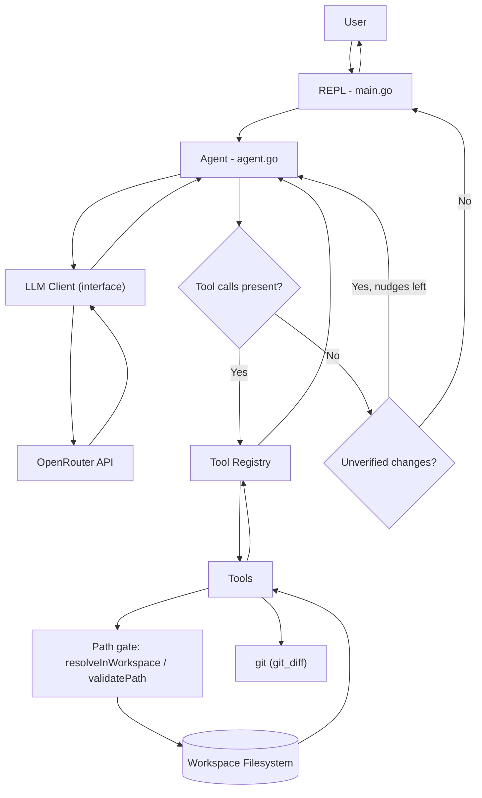
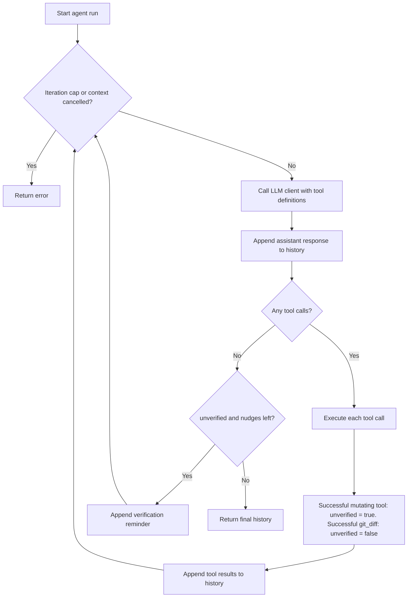

# zerrcode

**An interactive AI coding assistant built in Go.**

`zerrcode` is a command-line coding assistant powered by an LLM through [OpenRouter](https://openrouter.ai/). It can understand natural-language requests, interact with files in a workspace, and execute tools through an iterative agent loop.

Instead of manually running individual file operations, you can ask the assistant to read, search, create, edit, or delete files using ordinary language, and it checks the resulting `git diff` before reporting that the work is done.

## Features

- **Interactive CLI** — chat with the assistant through a REPL.
- **Streaming responses** — receive generated text as it arrives.
- **Tool calling** — the model can request file operations based on your instructions.
- **Built-in tools** — read, list, search, write, edit (multi-file patches), and delete files, plus a read-only `git_diff`.
- **Iterative agent loop** — execute tool calls, append their results to conversation history, and continue until the model returns a final response. The loop is bounded and cancellable.
- **Verification before completion** — after changing files the agent must inspect `git_diff` before it is allowed to finish.
- **Honest reporting** — the system prompt separates commands the agent actually ran from ones it could not run.
- **Workspace path validation** — reject paths that escape the workspace, including through symlinks.
- **Context-aware execution** — propagate context cancellation through agent and tool operations.
- **Modular architecture** — the agent, LLM client, and tools are separate packages behind interfaces; tools describe themselves.

## Built With

- **Go** — core application and agent implementation.
- **OpenRouter** — LLM API access.
- **OpenRouter Go SDK** — chat completions, streaming, and tool calling.
- **godotenv** — loading environment variables from `.env`.
- **go-gitdiff** — parsing and applying unified diffs for `edit_file`.

## Requirements

- Go 1.27 or later (see `go.mod`).
- An OpenRouter API key.
- Git (also used at runtime by the `git_diff` tool).
- `grep` (used by the `search_code` tool).

## Getting Started

### 1. Clone the repository

```bash
git clone https://github.com/Aneeshie/zerrcode.git
cd zerrcode
```

### 2. Install dependencies

```bash
go mod tidy
```

### 3. Configure your API key

Create a `.env` file in the project root:

```env
OPENROUTER_API_KEY=your_openrouter_api_key
```

Get your API key from [OpenRouter](https://openrouter.ai/).

**Important:** Never commit your API key or other secrets to version control.

### 4. Run zerrcode

```bash
go run .
```

You should see the interactive prompt:

```text
zerrcode — type 'exit' to quit.

zerrcode >
```

You can now start interacting with the assistant.

### 5. Build the executable

To build a standalone executable:

```bash
go build -o zerrcode .
```

Run it with:

```bash
./zerrcode
```

## Usage

Once the REPL starts, enter requests in natural language.

### List files

```text
zerrcode > list the files in the current directory
```

The assistant can invoke the `list_files` tool to inspect the workspace.

### Read a file

```text
zerrcode > read main.go and explain what it does
```

The assistant can read the requested file and use its contents to answer your question.

### Create a file

```text
zerrcode > create hello.go that prints Hello, World
```

The assistant can invoke `write_file` to create the file.

### Edit files

```text
zerrcode > rename the variable x to count in main.go and update its callers
```

The assistant can invoke `edit_file` with a unified diff (one patch can change several files), then call `git_diff` to verify the result.

### Delete a file

```text
zerrcode > delete hello.go
```

The assistant can invoke `delete_file` to remove the requested file.

### Exit

```text
zerrcode > exit
Goodbye!
```

The examples above illustrate the intended interactions. Exact tool selection and output depend on the model's response and the requested operation.

## Built-in Tools

`zerrcode` exposes workspace operations to the model through a tool registry.

| Tool | Changes workspace | Purpose |
|---|---|---|
| `read_file` | no | Read the contents of a file. |
| `list_files` | no | List files and directories within a directory. |
| `search_code` | no | Literal-text search across files (wraps `grep`). |
| `git_diff` | no | Show changed files and the diff against `HEAD`. |
| `write_file` | yes | Create a file or fully overwrite one. |
| `edit_file` | yes | Apply a multi-file unified diff, all-or-nothing. |
| `delete_file` | yes | Delete a file. |

Each tool implements the common `Tool` interface and describes itself, including the JSON schema the model sees:

```go
type Tool interface {
    Name() string
    Description() string
    InputSchema() map[string]any
    Execute(ctx context.Context, input string) (string, error)
}

// Optional: tools that change the workspace implement it.
type Mutator interface {
    Mutates() bool
}
```

The registry maps tool names to implementations, provides a common execution path (`Execute`), lists tools (`All`), and reports whether a tool changes the workspace (`IsMutating`).

Tools receive their arguments as JSON strings, validate them strictly (unknown fields and trailing JSON values are rejected), and return a result or an error.

For how every tool works in detail see [`tools.md`](tools.md).

## How It Works

The application follows an iterative agent architecture.

1. The REPL reads the user's input.
2. The input is appended to the conversation history (which starts with the system prompt).
3. The agent builds tool definitions from the registry and sends the history to the LLM client.
4. The client streams the response and assembles any tool calls.
5. If the model requests tools, the agent executes them through the registry. Errors are returned to the model as tool results.
6. Tool results are appended to the conversation history.
7. The agent makes another LLM request using the updated history.
8. When the model returns a response with no tool calls, the agent checks that any changes it made have been verified with `git_diff`. If not, it sends the model back to verify.
9. Otherwise the agent returns the final conversation history to the REPL.

### Architecture Diagram



### Layers

| Layer | Responsibility | Knows about |
|---|---|---|
| `main.go` | Chooses a client, registers tools, runs the REPL. | Everything; it is the only place that wires things together. |
| `internal/agent` | The loop: call the model, run tool calls, feed results back, enforce limits and verification. | The `LLMClient` interface and the `Registry`. Nothing about OpenRouter or any specific tool. |
| `internal/client` | Translate between internal types and the OpenRouter SDK. | The SDK, `Message`, `ToolDefinition`. |
| `internal/tools` | The capabilities themselves. | The filesystem, `grep`, `git`, and the workspace root. |

### Agent Loop



Behaviours worth knowing:

- **Bounded.** `Agent.MaxIterations` (default 25) limits model round-trips per run; exceeding it returns `ErrMaxIterations`. `<= 0` disables the cap.
- **Cancellable.** The context is checked before every model call.
- **Errors are data.** A tool error becomes `Tool call failed: <error>` in the tool result so the model can recover. A client (LLM) error ends the run.
- **Verification.** After any successful call to a `Mutator` tool, the run is *unverified* until `git_diff` succeeds. If the model tries to finish while unverified, the agent appends a reminder and continues, at most `MaxVerificationNudges` times (default 2; `<= 0` disables). Failed changes do not count, and a later change makes an earlier verification stale. The agent can force the model to *call* `git_diff`, but not to judge the diff correctly.

### System Prompt

`agent.SystemPrompt` (`internal/agent/prompt.go`) is used by `main.go` as the first message. It tells the model that:

- it can act only through its tools and has **no shell** (it cannot run tests, builds, or other commands);
- it must never claim to have run or verified something without a matching tool result, and must give the user the exact command for anything it cannot run;
- its final report keeps two lists apart: **Done and observed** and **Not run / not verified**;
- it should prefer small `edit_file` patches, and if one fails it must re-read the file and write a fresh patch instead of rewriting the whole file;
- after changing files it must call `git_diff` and check the changed-file list and hunks before reporting completion.

The prompt is guidance; the iteration cap and the verification nudge are the parts enforced in code.

## Project Structure

```text
zerrcode/
├── main.go
├── go.mod
├── go.sum
├── .env
├── .gitignore
├── LICENSE
├── README.md
├── docs/
│   ├── architecture.md     # this file
│   ├── decisions.md        # design decisions, trade-offs, change log
│   └── tools.md            # how each tool works
└── internal/
    ├── agent/
    │   ├── agent.go        # agent loop, iteration cap, verification
    │   ├── prompt.go       # SystemPrompt
    │   ├── agent_test.go
    │   └── prompt_test.go
    ├── client/
    │   ├── client.go
    │   └── openrouter-client.go
    └── tools/
        ├── tool.go         # Tool and Mutator interfaces
        ├── registry.go
        ├── path.go         # resolveInWorkspace (symlink-aware)
        ├── read_file.go
        ├── list_files.go
        ├── search_code.go
        ├── git_diff.go
        ├── write_file.go
        ├── edit_file.go    # also holds validatePath
        ├── delete_file.go
        └── *_test.go
```

### Key Components

**`main.go` — CLI entry point**

Initializes the client and tool registry, registers the built-in tools, and runs the interactive REPL.

**`internal/agent/agent.go` — Agent loop**

Coordinates LLM requests, tool execution, and conversation history. Enforces the iteration cap, context cancellation, and the verify-before-finishing rule.

**`internal/agent/prompt.go` — System prompt**

Holds `SystemPrompt`, including the rules about honest reporting, `edit_file` retries, and verification.

**`internal/client/client.go` — Client abstractions**

Defines the internal message types, tool-call types, streaming events, and `LLMClient` interface.

**`internal/client/openrouter-client.go` — OpenRouter integration**

Converts internal messages and the `ToolDefinition`s it is given into the SDK's request format, handles streamed responses, and assembles the final message and tool calls. It contains no tool-specific code.

**`internal/tools/tool.go` — Tool interface**

Defines the `Tool` contract (including each tool's own JSON schema) and the optional `Mutator` interface.

**`internal/tools/registry.go` — Tool registry**

Registers tools, looks them up by name, dispatches execution requests, and reports whether a tool changes the workspace.

**`internal/tools/path.go` — Workspace path validation**

`resolveInWorkspace` resolves a path and checks that it stays within the workspace root, both lexically and after following symlinks, before any filesystem operation. `edit_file.go` adds the stricter `validatePath` used for model-supplied paths.

**`internal/tools/` — Tools**

The implementations for reading, listing, searching, diffing, writing, editing, and deleting. See [`tools.md`](tools.md).

## Configuration

The application uses the following environment variable:

| Variable | Description |
|---|---|
| `OPENROUTER_API_KEY` | API key used to authenticate with OpenRouter. |

The configured model is currently:

```text
nvidia/nemotron-3.5-super-vl:free
```

The OpenRouter client configures streaming and sends the model whatever tool definitions the agent passes in; it does not know which tools exist.

To change the model, update the model configuration in `internal/client/openrouter-client.go`.

## Security Considerations

Because `zerrcode` can modify files, filesystem access is constrained in layers.

- **Workspace confinement.** Every tool resolves paths through `resolveInWorkspace`, which rejects paths outside the workspace lexically (`../../etc/passwd`) and after resolving symlinks (a symlink inside the workspace pointing outside is refused). Creating new files still works because only the existing part of the path is resolved.
- **Stricter validation for patches and diffs.** `edit_file` (every path in a patch) and `git_diff` also reject absolute paths, any `..` segment, any `.git` component, control characters (including NUL), and paths over 4096 bytes.
- **All-or-nothing edits.** `edit_file` validates every file and computes every result in memory before writing anything.
- **No clobbering.** `edit_file` will not overwrite a file with a create/rename, and a path may appear only once per patch.
- **Appropriate targets.** Tools check that a target is a regular file or directory as the operation requires; `delete_file` refuses directories.
- **Strict inputs.** JSON arguments are decoded with unknown fields and trailing values rejected.
- **Read-only git.** `git_diff` passes only fixed arguments to git, never raw model text, and never writes to the repository.
- **Bounded work.** The agent loop has an iteration cap, tools cap their output (`search_code` 32 KB, `git_diff` 64 KB), and `edit_file` is limited to 50 files per patch.
- **Cancellation** is checked during tool execution.

These checks help constrain filesystem operations, but they should not be treated as a complete security sandbox. Symlink checks are subject to time-of-check/time-of-use races, and concurrent filesystem changes and filesystem permissions need careful consideration when hardening the application for untrusted workspaces. `.git` protection currently applies to `edit_file` and `git_diff` only. See [`decisions.md`](decisions.md#known-limitations) for the full list of known limitations.

**Recommendation:** Run the assistant in a dedicated workspace (ideally a git repository, so changes can be reviewed and reverted) and review its file-modification behavior before using it on important data.

## Development

Run the application:

```bash
go run .
```

Format the code:

```bash
gofmt -w .
```

Run the test suite:

```bash
go test ./...
```

Run static analysis:

```bash
go vet ./...
```

## Documentation

- [`docs/architecture.md`](docs/architecture.md) — components, request lifecycle, agent loop, and security model (this document).
- [`docs/tools.md`](docs/tools.md) — how each tool works: inputs, validation, output, and failure behaviour.
- [`docs/decisions.md`](docs/decisions.md) — design decisions with their reasoning and trade-offs, known limitations, and the change log.

## Contributing

Contributions, bug reports, and suggestions are welcome.

1. Fork the repository.
2. Create a branch for your changes.
3. Implement and test your changes.
4. Open a pull request describing the change.

## License

This project is licensed under the MIT License. See [`LICENSE`](LICENSE) for details.
