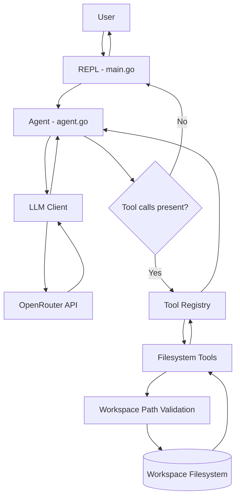
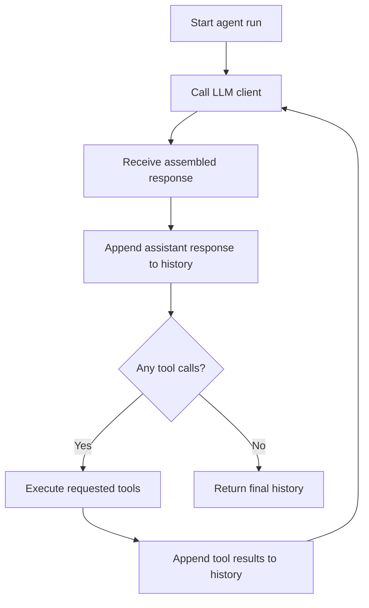

# zerrcode

**An interactive AI coding assistant built in Go.**

`zerrcode` is a command-line coding assistant powered by an LLM through [OpenRouter](https://openrouter.ai/). It can understand natural-language requests, interact with files in a workspace, and execute tools through an iterative agent loop.

Instead of manually running individual file operations, you can ask the assistant to read, list, create, or delete files using ordinary language.

## Features

- **Interactive CLI** — chat with the assistant through a REPL.
- **Streaming responses** — receive generated text as it arrives.
- **Tool calling** — the model can request file operations based on your instructions.
- **Built-in filesystem tools** — read, list, write, and delete files.
- **Iterative agent loop** — execute tool calls, append their results to conversation history, and continue until the model returns a final response.
- **Workspace path validation** — reject paths that escape the configured workspace.
- **Context-aware execution** — propagate context cancellation through agent and tool operations.
- **Modular architecture** — separate the agent, LLM client, and filesystem tools behind interfaces.

## Built With

- **Go** — core application and agent implementation.
- **OpenRouter** — LLM API access.
- **OpenRouter Go SDK** — chat completions, streaming, and tool calling.
- **godotenv** — loading environment variables from `.env`.

## Requirements

- Go 1.17 or later.
- An OpenRouter API key.
- Git.

## Getting Started

### 1. Clone the repository

```bash
git clone https://github.com/Aneeshie/zerrcode.git
cd zerrcode
```

### 2. Install dependencies

```bash
go mod tidy
```

### 3. Configure your API key

Create a `.env` file in the project root:

```env
OPENROUTER_API_KEY=your_openrouter_api_key
```

Get your API key from [OpenRouter](https://openrouter.ai/).

**Important:** Never commit your API key or other secrets to version control.

### 4. Run zerrcode

```bash
go run .
```

You should see the interactive prompt:

```text
zerrcode — type 'exit' to quit.

zerrcode >
```

You can now start interacting with the assistant.

### 5. Build the executable

To build a standalone executable:

```bash
go build -o zerrcode .
```

Run it with:

```bash
./zerrcode
```

## Usage

Once the REPL starts, enter requests in natural language.

### List files

```text
zerrcode > list the files in the current directory
```

The assistant can invoke the `list_files` tool to inspect the workspace.

### Read a file

```text
zerrcode > read main.go and explain what it does
```

The assistant can read the requested file and use its contents to answer your question.

### Create a file

```text
zerrcode > create hello.go that prints Hello, World
```

The assistant can invoke `write_file` to create the file.

### Delete a file

```text
zerrcode > delete hello.go
```

The assistant can invoke `delete_file` to remove the requested file.

### Exit

```text
zerrcode > exit
Goodbye!
```

The examples above illustrate the intended interactions. Exact tool selection and output depend on the model's response and the requested operation.

## Built-in Tools

`zerrcode` exposes filesystem operations to the model through a tool registry.

| Tool | Purpose |
|---|---|
| `read_file` | Read the contents of a file. |
| `list_files` | List files and directories within a directory. |
| `write_file` | Create or overwrite a file. |
| `delete_file` | Delete a file. |

Each tool implements the common `Tool` interface:

```go
type Tool interface {
    Name() string
    Description() string
    Execute(ctx context.Context, input string) (string, error)
}
```

The registry maps tool names to their implementations and provides a common execution path.

Tools receive their arguments as JSON strings, validate their inputs, and return a result or an error.

## How It Works

The application follows an iterative agent architecture.

1. The REPL reads the user's input.
2. The input is appended to the conversation history.
3. The agent sends the history to the LLM client.
4. The client streams the response and assembles any tool calls.
5. If the model requests tools, the agent executes them through the registry.
6. Tool results are appended to the conversation history.
7. The agent makes another LLM request using the updated history.
8. When no more tool calls are returned, the agent returns the final conversation history to the REPL.

### Architecture Diagram



### Agent Loop

The agent continues making requests until the model returns a response without tool calls.



## Project Structure

```text
zerrcode/
├── main.go
├── go.mod
├── go.sum
├── .env
├── .gitignore
├── LICENSE
├── README.md
├── docs/
│   └── architecture.md
└── internal/
    ├── agent/
    │   └── agent.go
    ├── client/
    │   ├── client.go
    │   └── openrouter-client.go
    └── tools/
        ├── tool.go
        ├── registry.go
        ├── path.go
        ├── read_file.go
        ├── list_files.go
        ├── write_file.go
        └── delete_file.go
```

### Key Components

**`main.go` — CLI entry point**

Initializes the client and tool registry, registers the built-in tools, and runs the interactive REPL.

**`internal/agent/agent.go` — Agent loop**

Coordinates LLM requests, tool execution, and conversation history.

**`internal/client/client.go` — Client abstractions**

Defines the internal message types, tool-call types, streaming events, and `LLMClient` interface.

**`internal/client/openrouter-client.go` — OpenRouter integration**

Converts internal messages into the SDK's request format, handles streamed responses, and assembles the final message and tool calls.

**`internal/tools/tool.go` — Tool interface**

Defines the common contract implemented by filesystem tools.

**`internal/tools/registry.go` — Tool registry**

Registers tools, looks them up by name, and dispatches execution requests.

**`internal/tools/path.go` — Workspace path validation**

Resolves paths and checks whether they remain within the workspace root before filesystem operations are performed.

**`internal/tools/` — Filesystem tools**

Contains the implementations for reading, listing, writing, and deleting files.

## Configuration

The application uses the following environment variable:

| Variable | Description |
|---|---|
| `OPENROUTER_API_KEY` | API key used to authenticate with OpenRouter. |

The configured model is currently:

```text
nvidia/nemotron-3.5-super-vl:free
```

The OpenRouter client configures streaming and exposes the four built-in filesystem tools to the model.

To change the model, update the model configuration in `internal/client/openrouter-client.go`.

## Security Considerations

Because `zerrcode` can modify files, filesystem access needs to be constrained.

The filesystem tools use workspace path validation to reject paths that resolve outside the workspace root.

The intended safeguards include:

- Rejecting path traversal attempts such as `../../etc/passwd`.
- Validating paths before filesystem operations.
- Checking whether a target is an appropriate file or directory for the requested operation.
- Rejecting directory deletion through the file deletion tool.
- Checking context cancellation during tool execution.
- Validating JSON arguments and rejecting unknown fields.

These checks help constrain filesystem operations, but they should not be treated as a complete security sandbox. In particular, symbolic links, concurrent filesystem changes, and filesystem permissions require careful consideration when hardening the application for untrusted workspaces.

**Recommendation:** Run the assistant in a dedicated workspace and review its file-modification behavior before using it on important data.

## Development

Run the application:

```bash
go run .
```

Format the code:

```bash
gofmt -w .
```

Run the test suite:

```bash
go test ./...
```

Run static analysis:

```bash
go vet ./...
```

## Documentation

For a deeper explanation of the system's components, request lifecycle, agent loop, and security model, see [`docs/architecture.md`](docs/architecture.md).

## Contributing

Contributions, bug reports, and suggestions are welcome.

1. Fork the repository.
2. Create a branch for your changes.
3. Implement and test your changes.
4. Open a pull request describing the change.

## License

This project is licensed under the MIT License. See [`LICENSE`](LICENSE) for details.
