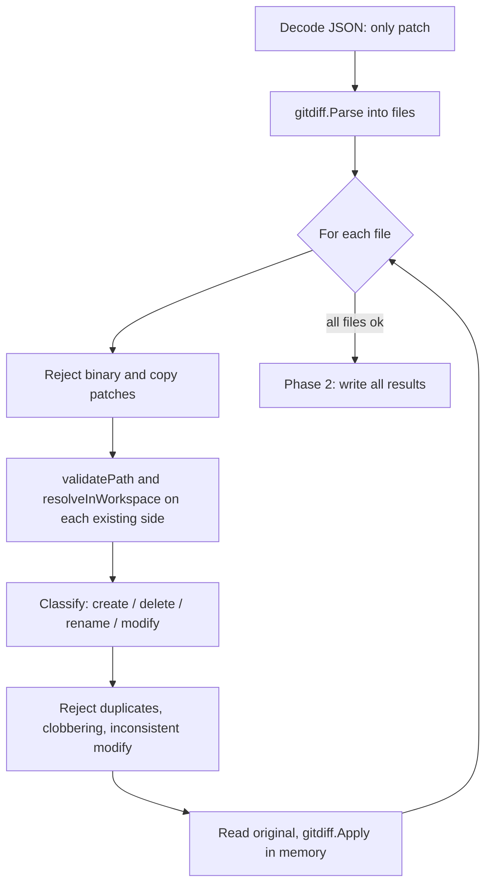

# Tools reference

This document explains how every tool the agent can call actually works: its input, what it validates, what it does, what it returns, and how it fails. For the reasoning behind the design see [`decisions.md`](decisions.md); for the overall structure see [`architecture.md`](architecture.md).

## Overview

| Tool | Changes the workspace | Purpose |
|---|---|---|
| [`read_file`](#read_file) | no | Return the contents of a file. |
| [`list_files`](#list_files) | no | List the entries of a directory. |
| [`search_code`](#search_code) | no | Literal-text search across files (wraps `grep`). |
| [`git_diff`](#git_diff) | no | Show changed files and the diff against `HEAD`. |
| [`write_file`](#write_file) | **yes** | Create a file or fully overwrite one. |
| [`edit_file`](#edit_file) | **yes** | Apply a multi-file unified diff, all-or-nothing. |
| [`delete_file`](#delete_file) | **yes** | Delete one file. |

The "changes the workspace" column is not documentation only: those three tools implement the `Mutator` interface, which the agent uses to decide when changes must be verified (see [Verification](#how-verification-uses-these-tools)).

## The `Tool` contract

```go
type Tool interface {
    Name() string
    Description() string
    InputSchema() map[string]any // JSON Schema sent to the model
    Execute(ctx context.Context, input string) (string, error)
}

// Optional. Tools that change the workspace implement it.
type Mutator interface {
    Mutates() bool
}
```

A tool receives its arguments as a raw JSON string from the model and returns a string result or an error. The agent never crashes on a tool error: it sends `Tool call failed: <error>` back to the model as the tool result, so the model can correct itself.

Each tool owns its schema (`InputSchema`) so the schema and the argument parsing live in the same file and cannot drift apart. The agent converts schemas into `client.ToolDefinition`s, and the OpenRouter client converts those into SDK types.

## Behaviour shared by all tools

**Strict argument parsing.** Every tool decodes with `DisallowUnknownFields` and then checks for trailing data. Consequences:
- A misspelled or extra field is an error, not silently ignored (`invalid <tool> arguments: json: unknown field "x"`).
- Two JSON values in one call (`{"path":"a"}{"path":"b"}`) are rejected with `multiple json values`.
- `list_files` and `git_diff` accept empty input (`""`) as "no arguments".

**Workspace confinement.** Paths go through `resolveInWorkspace(root, path)` in `internal/tools/path.go`:

1. Join the path onto the absolute workspace root and clean it.
2. Reject it if the result is outside the root (lexical check, catches `..`).
3. Resolve symlinks on the longest *existing* prefix of the path and reject it if the real location is outside the real root. Resolving only the existing prefix is what lets tools still create files that do not exist yet.

Violations return `path is outside the workspace`. An absolute path such as `/etc/passwd` is joined *under* the root (it becomes `<root>/etc/passwd`) and so is contained; `edit_file` and `git_diff` additionally reject absolute paths outright via [`validatePath`](#validatepath).

**Cancellation.** Tools check `ctx.Done()` before doing filesystem work.

## `read_file`

Reads one file.

| | |
|---|---|
| Input | `{"path": "<file>"}` (required) |
| Output | The file's raw contents as a string. |

Flow: parse args → reject empty/blank path (`path is required`) → `resolveInWorkspace` → `os.Stat` (missing file → `inspect file: …`) → must be a regular file (`path is not a regular file` for directories etc.) → check context → `os.ReadFile`.

Notes: there is no size limit, so very large files are returned in full.

## `list_files`

Lists one directory, non-recursively.

| | |
|---|---|
| Input | `{"path": "<dir>"}` (optional; empty or omitted means the workspace root) |
| Output | Sorted entry names, one per line. Directories end with `/`. An empty directory returns an empty string. |

Example output:

```text
README.md
docs/
internal/
main.go
```

Errors: missing directory → `inspect directory: …`; a file instead of a directory → `path is not a directory`.

## `search_code`

Literal text search implemented by running the system `grep`.

| | |
|---|---|
| Input | `{"query": "<text>", "path": "<dir or file>", "file_pattern": "<glob>"}`; only `query` is required. |
| Output | `grep -n` style lines: `relative/path:line:matching text`. `No matches found` when nothing matched. |

How it runs: `grep -rnIF --exclude-dir=.git [--include=<file_pattern>] -e <query> -- <path>`, executed with the workspace root as the working directory and a path relative to it, so results are short and relative.

Details that matter:
- `-F` means the query is a **literal string**, not a regex (`a.b` matches only `a.b`).
- `-e <query>` and `--` mean queries beginning with `-` (for example `--version`) are not read as flags.
- `-I` skips binary files; `--exclude-dir=.git` skips git metadata.
- grep exit code 1 (no match) is **not** an error. Any other failure returns `grep failed: …` including grep's stderr.
- An empty or blank query returns `query is required`.
- Output is capped at 32 KB with a trailing `... output truncated, narrow your search`.
- Stdout and stderr are captured separately so stderr noise never appears in results.

Dependency: requires `grep` on the `PATH`. Its tests skip themselves if it is missing.

## `git_diff`

A read-only view of what changed. It exists so the agent can inspect its own work before claiming it is finished.

| | |
|---|---|
| Input | `{"path": "<file or dir>"}` (optional; limits the output) |
| Output | The changed-file list followed by the diff against `HEAD`. |

Example output:

```text
Changed files (git status --porcelain):
 M internal/agent/agent.go
?? internal/tools/git_diff.go

Note: untracked files (??) are listed but not shown in the diff; use read_file to inspect them.

Diff against HEAD:
diff --git a/internal/agent/agent.go b/internal/agent/agent.go
...
```

Flow:
1. Parse args; if `path` is set, run it through `validatePath` and `resolveInWorkspace`, then convert it to a path relative to the root.
2. `git rev-parse --is-inside-work-tree`; if it fails: `workspace is not a git repository, cannot verify changes`.
3. `git status --porcelain=v1 --untracked-files=all`. If it is empty the tool returns `No changes in the working tree.`
4. `git diff --no-color --no-ext-diff --no-textconv HEAD` (falls back to a plain `git diff` in a repository with no commits yet).
5. Output over 64 KB is truncated with a hint to pass a `path`.

Safety: only fixed arguments built by the tool are passed to git, never raw model text. It runs with `--no-pager`, `--no-optional-locks`, `GIT_TERMINAL_PROMPT=0`, and never writes to the repository.

Limitation: untracked files appear in the file list but not in the diff, because `git diff` does not show them.

## `write_file`

Creates a file or **fully replaces** an existing one.

| | |
|---|---|
| Input | `{"path": "<file>", "content": "<full new content>"}` (both required; empty content is allowed) |
| Output | `created <path> (<n> bytes)` or `updated <path> (<n> bytes)` |

Flow: parse args → `path is required` check → `resolveInWorkspace` → `os.Stat`: if the target exists it must be a regular file (`path is not a regular file`) and its permission bits are remembered; a missing target is fine → check context → `os.MkdirAll` the parent directories → `os.WriteFile` with the remembered permissions (`0644` for new files).

Notes:
- It writes the whole file. For changing part of an existing file prefer `edit_file`: overwriting from a possibly stale memory of the file can silently discard content (see [`decisions.md`](decisions.md#6-edit_file-failures-must-not-fall-back-to-rewriting-the-file)).
- Existing file modes are preserved, so rewriting an executable script keeps it executable.
- The write is not atomic (no temp-file-and-rename).

## `edit_file`

Applies a **unified diff** to the workspace. The patch itself names every file it touches; there is no separate `path` argument.

| | |
|---|---|
| Input | `{"patch": "<unified diff>"}` (required) |
| Output | One line per file: `modified <path>`, `created <path>`, `deleted <path>` or `renamed <old> -> <new>`. |

A single patch can modify, create, delete and rename several files:

```diff
--- a/main.go
+++ b/main.go
@@ -1,3 +1,3 @@
 package main
-var x = 1
+var x = 2
 func main() {}
--- /dev/null
+++ b/notes/new.txt
@@ -0,0 +1,2 @@
+hello
+world
--- a/old.txt
+++ /dev/null
@@ -1,2 +0,0 @@
-x
-y
```

### Two phases



**Phase 1 – validate and compute, write nothing.** For every file in the patch:
- Binary patches and copy patches are rejected.
- Only the side that exists is validated: the *old* path for modify/delete/rename, the *new* path for create/modify/rename (gitdiff leaves the old name empty for new files and the new name empty for deletions).
- Each name is checked by [`validatePath`](#validatepath) and then `resolveInWorkspace` (symlink-aware).
- A modify whose old and new paths differ is rejected unless the patch marks it as a rename.
- A path may appear only once in a patch (a later entry would be applied against content that no longer matches what was validated).
- A create or rename may not overwrite an existing file (`<name> already exists`).
- For anything that is not a create: the original must exist and be a regular file; it is read into memory.
- `gitdiff.Apply` produces the new content in memory. A hunk that does not match returns an error.
- At most 50 files per patch.

**Phase 2 – write.** Only if every file passed phase 1: creates (with parent directories), modifications (preserving file mode), deletes and renames (write new, remove old) are performed in order.

### Path prefixes

Plain `---`/`+++` diffs use `a/` and `b/` prefixes; `gitdiff` keeps them for plain diffs but has already stripped them inside `diff --git` blocks. `stripDiffPrefix` therefore strips one `a/` or `b/` **only** for plain diffs and leaves git-format names alone, so a real path like `b/x.go` in a git-format patch is not mangled.

### Failure behaviour

If a hunk does not apply, nothing is written and the error tells the model what to do:

```text
apply patch to a.txt: <detail>. No files were modified. Do not fall back to write_file or rewrite the
whole file. Re-read "a.txt" with read_file, then generate a new, minimal patch with fresh context
lines copied from its current content.
```

The tool description says the same thing. This is guidance to the model, not a technical block (`write_file` remains legitimate for new files).

### Limitations

- Phase 2 is not transactional. If a write fails part-way (for example a permissions error) earlier files stay written; the error lists which ones.
- Format detection is per patch: a patch mixing plain and `diff --git` sections is treated as git format throughout.
- In a plain diff with no `a/`/`b/` prefixes, a real top-level directory named `a` or `b` would be stripped.
- Binary patches are unsupported.

## `delete_file`

Deletes one file.

| | |
|---|---|
| Input | `{"path": "<file>"}` (required) |
| Output | `deleted <path>` |

Flow: parse args → `path is required` → `resolveInWorkspace` → `os.Lstat` (missing → `inspect file: …`) → directories are refused (`path is a directory, not a file`) → check context → `os.Remove`.

Notes:
- It never removes directories, so it cannot recursively delete anything.
- Because paths are symlink-resolved before the check, a symlink that points outside the workspace is refused rather than deleted.

## `validatePath`

A stricter gate used by `edit_file` (for every path in a patch) and `git_diff` (for its `path`). It exists because these paths come from model-generated text and a silent "fix-up" would hide a wrong patch from the model.

It rejects, in order:

| Rule | Error contains |
|---|---|
| empty or blank path | `path is required` |
| (`/dev/null` is allowed as the placeholder for the missing side of a create/delete) | |
| longer than 4096 bytes | `too long` |
| any control character, including NUL and newline | `control characters` |
| absolute path (`/x`, `\x`, or a drive/volume name) | `relative` |
| any `..` segment, even harmless ones like `a/../b` | `'..'` |
| any `.git` path component | `.git` |
| resolves outside the workspace, including via symlinks | `outside the workspace` |

`.git` protection exists only here; `write_file` and `delete_file` do not apply it.

## How verification uses these tools

After any **successful** call to a `Mutator` tool (`write_file`, `edit_file`, `delete_file`) the agent considers the workspace *unverified* until `git_diff` has been called. If the model tries to finish while unverified, the agent appends a reminder and sends it back, up to `MaxVerificationNudges` times (default 2). Failed changes do not trigger it, and a later change makes an earlier `git_diff` stale. Details are in [`architecture.md`](architecture.md#agent-loop).
